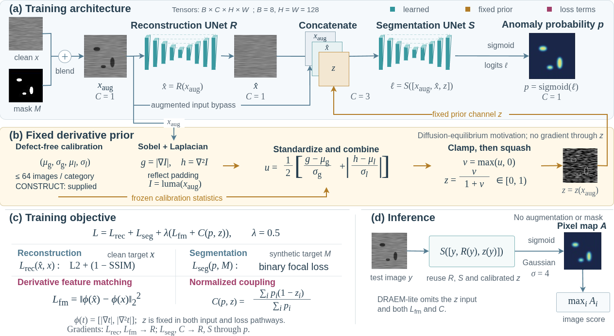

# When Do Derivative Priors Help Industrial Anomaly Detection? A Controlled Study of Features, Losses, and Failure Modes

**Naseer Ahmed Khan, Shabih Ul Hassan, Wei Xiaokun, Bian Yuhao, and Lu Zhongqing**



Official code for training and evaluating the matched twin detectors
(PGDN and its data-driven twin) and reproducing the paper's central
component analyses: the input × coupling factorial, the smooth-defect
family assay, the coupling-weight intervention, the gradient probes,
and the real-defect moderation analysis.

## Repository layout

| Path | Contents |
|---|---|
| `train.py`, `eval.py`, `losses.py`, `infer.py` | Training and evaluation: matched twin implementation, epsilon-stabilized batch coupling loss, focal/SSIM reconstruction, Sobel/Laplacian prior calibration, Gaussian-σ4 evaluation smoothing |
| `models/`, `datasets/`, `physics/` | Networks (PGDN, DRAEM-lite, PatchCore-lite), MVTec-layout loaders with deterministic per-image augmentation, derivative operators |
| `drivers/` | Experiment drivers: `factorial_driver.sh` (component factorial), `ref_recipe_driver.sh` + `ref_family_score.py` + `ref_protocol_analyze.py` (stronger-recipe replication with the frozen K/D/B/T contrasts) |
| `defect_family_sweep.py`, `smooth_defect_test.py`, `smooth_factorial_rep.py` | Perlin/smooth paired-defect family assays |
| `gradient_probe.py`, `gradient_probe_params.py` | Output-space and parameter-level coupling-gradient probes |
| `real_moderation.py`, `moderation_bootstrap.py`, `real_prior_bridge.py` | Real-defect moderation analysis and the released 10,000-replicate paired bootstrap |
| `tools/` | Defect-level coverage exports, spatial probes, batch-context diagnostic |
| `results/` | Released result records (factorial endpoints, family sweeps, moderation records, routing pairs, run manifest with checkpoint hashes) backing the paper's tables and figures |

## Setup

```bash
pip install -r requirements.txt
```

Benchmarks are used in the MVTec folder layout
(`train/good`, `test/{good,<defect_type>}`, `ground_truth/<defect_type>`).
Set `PGDN_RUNS_ROOT` to your checkpoint directory (default `runs/`) and
`PGDN_REQUIRE_PRETRAINED=1` when the pretrained PatchCore baseline must
fail loudly rather than fall back.

## Reproduce the central results

```bash
# 1. component factorial (8 arms x categories, matched recipe)
bash drivers/factorial_driver.sh <shard>

# 2. smooth-defect family assay on frozen checkpoints
python defect_family_sweep.py

# 3. stronger-recipe replication (4 arms x 3 categories x 3 seeds)
bash drivers/ref_recipe_driver.sh
python drivers/ref_family_score.py        # paired Perlin/smooth scoring
python drivers/ref_protocol_analyze.py    # frozen K/D/B/T contrasts + verdict

# 4. real-defect moderation with the released bootstrap
python real_moderation.py && python moderation_bootstrap.py

# 5. verify released records
python repeatability.py   # same-configuration repeat spread
```

Training uses one fixed synthetic-defect realization per training image
(deterministic augmentation, no clean-image branch); see the paper's
method section for the exact recipe and deviations from DRAEM.

## Citation

If you use this code, please cite the paper.
